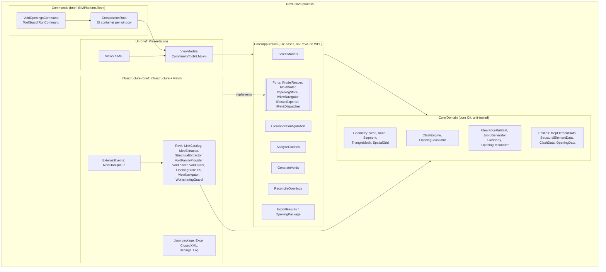
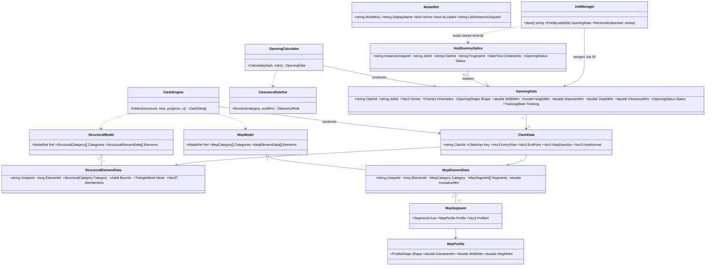
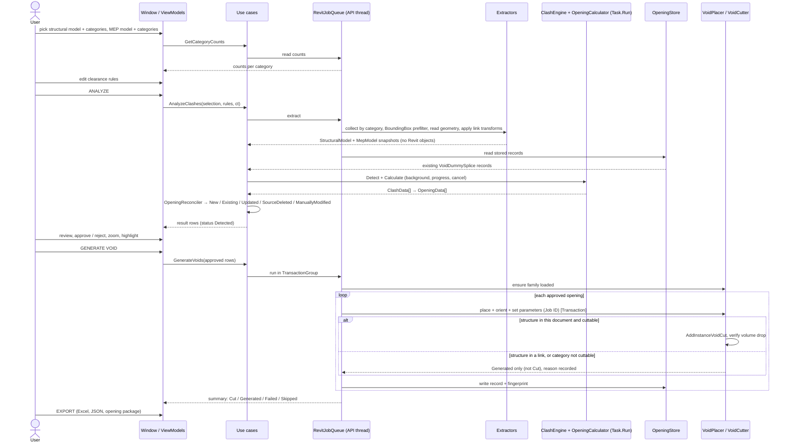

# Void Openings — design (first deliverable, A–G)

Status: **approved by the owner on 2026-11-11. All phases are implemented (tool 0.9.0, plugin 6.51.0); none is tested in Revit yet.**
Date: 2026-11-10 · Target: Revit 2026, .NET 8, WPF, plugin `Revit26_Plugin_Revised`.

UI wireframe (deliverable C): `Claude/Previews/VoidOpenings_V001_Window.html`, published at
https://claude.ai/artifact/Ch9vZ7dfEa5kHAksAE9GQH.

## 0. Brief, decisions, assumptions

**What the tool does.** Finds where MEP elements pass through structural elements (each side may be a
Revit link), sizes an opening from user clearance rules, places a void family instance with a unique
Job ID, cuts the structure where Revit allows it, tracks every opening across re-runs, and exports results.
One structural model and one MEP model per run; the run is repeatable.

**Decided by the owner**

| # | Decision |
|---|---|
| D1 | Built as a tool inside `Revit26_Plugin_Revised` (not a separate `BIMPlatform.sln`). The brief's layers are kept as folders and namespaces. |
| D2 | The void family is built by the plugin through the API by default; the window also accepts a custom `.rfa` that has the required parameters. |

**Working assumptions.** The owner approved the spec without answering the questions in section 9, so
these recommended answers are in force until the owner says otherwise.

- A1. Both selectors also offer **"(Active model)"**, so host structure (Scenario A) and host MEP work. *Confirmed by the owner 2026-11-11.*
- A2. Ribbon: a new one-button panel **Coordination** on `Rafi_Pro_Docs2`, button label **Void Openings**. *Confirmed by the owner 2026-11-11.*
- A3. When the structure is a link, the host gets **no void instances** by default; the openings are kept as
  records and exported as a package. An option places uncut reference markers in the host.
- A4. v1 makes one opening per MEP element per penetration. Merging nearby openings into one combined
  opening is a later version.
- A5. Insulation thickness is added to the MEP size (option, on by default).

## A. Architecture

The brief's six projects map onto one tool folder. Dependencies point inwards only.



Rules that keep the layers honest:

- `Core/Domain` and `Core/Application` contain **no** `using Autodesk.*` and no `System.Windows.*`.
  `Tests/VoidOpenings.Tests` links `Core/**` into a plain `net8.0` project with no Revit or WPF
  reference (the same pattern as `Tests/TrackerId.Tests`), so a violation fails the test build.
- Revit objects never leave `Infrastructure/Revit`. Extractors return domain snapshots (points in
  millimetres, host coordinates). Only snapshots enter `Task.Run`.
- View models call use cases; they hold no geometry or Revit logic. Code-behind only wires the window.
- Every `IExternalCommand.Execute` and `IExternalEventHandler.Execute` goes through `ToolGuard`.

## B. Folder and project structure

No new solution. One new tool folder, one new test project, one `ToolCatalog` entry
(`VoidOpenings`, `0.2.0` while in development and `1.0.0` when all phases are done, `V001`, namespace `Revit26_Plugin_Revised.VoidOpenings.V001`).

```
Menu/Coordination/Openings/VoidOpenings_V001/
  Commands/
    VoidOpeningsCommand.cs            IExternalCommand → ToolGuard.RunCommand, opens the modeless window
    CompositionRoot.cs                registers services, builds the provider, disposes with the window
  Core/
    Domain/
      Geometry/     Vec3, Aabb, Segment3, Triangle, TriangleMesh, Frame3, SpatialGrid, Intersect (Möller–Trumbore)
      Entities/     ModelRef, StructuralElementData, MepElementData (+ MepSegment, MepProfile), ClashData, OpeningData
      Rules/        ClearanceRule, ClearanceRuleSet, ClearanceMode, OpeningShapePolicy
      Services/     ClashEngine, OpeningCalculator, ClashKey, JobIdGenerator, OpeningReconciler
      Enums.cs      StructuralCategory, MepCategory, OpeningShape, OpeningStatus, TrackingState
    Application/
      Ports/        IModelReader, IVoidWriter, IOpeningStore, IViewNavigator, IResultExporter, IRevitDispatcher, ISettingsStore
      Features/
        ModelSelection/          GetModelsQuery, GetCategoryCountsQuery
        ClearanceConfiguration/  LoadRules, SaveRules, ValidateRules
        ClashDetection/          AnalyzeClashesUseCase (extract → detect → size → reconcile)
        VoidPlacement/           GenerateVoidsUseCase (place → cut → verify → record)
        JobManagement/           JobManager (next id, find by Job ID, state transitions)
        Reporting/               ExportResultsUseCase, OpeningPackage (export / apply)
      Dtos/         ModelInfoDto, CategoryCountDto, ClashRowDto, RunSummaryDto, OpeningPackageDto
  Infrastructure/
    Revit/          LinkCatalog, CategoryMap, StructuralExtractor, MepExtractor, UnitsMm,
                    VoidFamilyBuilder, VoidFamilyProvider, VoidFamilySpec, VoidPlacer, VoidCutter,
                    CutVerifier, CutFailureCollector, OpeningStoreEs (Extensible Storage v1),
                    JobCounterStore, ViewNavigator, WorksharingGuard, RevitModelReader, RevitVoidWriter
    ExternalEvents/ RevitJobQueue (the TrackerId_V002 pattern), RevitDispatcher
    Json/           OpeningPackageJson, SettingsJson (both with a "version" field)
    Excel/          ResultsWorkbookExporter (ClosedXML)
  UI/
    Views/          VoidOpeningsWindow.xaml, ModelPanel.xaml, ClearanceRulesView.xaml, ResultsView.xaml
    ViewModels/     MainViewModel, ModelPanelViewModel, CategoryItemViewModel, ClearanceRulesViewModel,
                    ClearanceRuleRowViewModel, ResultsViewModel, ClashRowViewModel, NotificationViewModel
Tests/VoidOpenings.Tests/             xunit, links Core/** only
  Geometry/  ClashEngine/  OpeningCalculator/  Clearance/  JobId/  Reconciler/  Package/
```

Also touched at implementation time: `Shared/Services/ToolCatalog.cs`, the ribbon file, `CHANGELOG.md`,
`README.md` and `RIBBON_AND_ICONS.md` ribbon tables, `<Version>` in the `.csproj`, the HTML preview.

NuGet: `CommunityToolkit.Mvvm` and `ClosedXML` are already referenced. New:
`Microsoft.Extensions.DependencyInjection` 8.0.x (risk R7).

Settings: `%AppData%\Revit26_Plugin_Revised\VoidOpenings\settings.json` (clearance rules, options, last
selection per model).

## C. UI wireframe

See `Claude/Previews/VoidOpenings_V001_Window.html`: ribbon button, one modeless window with the
STRUCTURAL MODEL and MEP MODEL panels side by side, the clearance rule grid, the action bar with
progress and cancel, the results table with row actions, and an in-window notification strip
(no `TaskDialog` for ordinary interaction).

## D. Class diagram



`PipeData` in the brief is `MepElementData`: one type covers pipes, conduits, ducts, trays and their
fittings, because the engine only needs centreline segments and a cross-section.

Class responsibilities (one job each):

| Class | Responsibility |
|---|---|
| `LinkCatalog` | Lists link instances (and the host), loaded state, total transform, model key. |
| `StructuralExtractor` / `MepExtractor` | Revit elements → domain snapshots in host millimetres. |
| `SpatialGrid` | Broad phase: which structural boxes a segment's box touches. |
| `ClashEngine` | Narrow phase: real intersections, entry/exit pairs, duplicate removal. |
| `ClearanceRuleSet` | Picks the rule for a category and size; falls back to the default. |
| `OpeningCalculator` | Shape, size, axis, depth and centre of one opening. |
| `ClashKey` | Stable identity of a clash, independent of `ElementId`. |
| `JobIdGenerator` / `JobManager` | Formats and issues `VOID-YYYY-NNNNNN`; lookup; state transitions. |
| `OpeningReconciler` | Compares detected openings with stored records → New / Existing / Updated / … |
| `VoidFamilyProvider` / `VoidFamilyBuilder` | Finds, validates, builds and loads the void families. |
| `VoidPlacer` / `VoidCutter` / `CutVerifier` | Places and orients an instance; adds the cut; proves it cut. |
| `OpeningStoreEs` / `JobCounterStore` | Persist records and the Job ID counter in the model. |
| `OpeningPackageJson` | Versioned hand-over file for the linked-structure workflow. |
| `RevitJobQueue` / `RevitDispatcher` | Runs work on the Revit API thread from the WPF window. |
| Use cases | Orchestrate ports and domain services; report progress; honour cancellation. |
| View models | Bind state and commands; no rules, no geometry. |

## E. Sequence



## F. Technical approach

### F1. Reading multiple linked models

- Links: `FilteredElementCollector(doc).OfClass(typeof(RevitLinkInstance))`. Loaded state from
  `RevitLinkType.GetLinkedFileStatus()`; `GetLinkDocument()` is `null` when unloaded, and such a link is
  listed but not selectable.
- Transform: `RevitLinkInstance.GetTotalTransform()` (covers moved, rotated and shared-coordinate links).
  Every point is transformed to host coordinates and converted to millimetres in the extractor.
- The same link type placed twice gives two rows; identity is the link instance `UniqueId` plus the
  linked model key (`ModelIdentity`: cloud GUIDs or central path).
- Nested links: collected from the parent link document, transform = parent × child. Revit only loads
  nested links whose reference type is *Attachment*; *Overlay* ones are not there to read.
- Elements: `FilteredElementCollector(linkDoc).OfCategory(...).WhereElementIsNotElementType()`.
  A `BoundingBoxIntersectsFilter` built from the other model's overall box (inverse-transformed into
  the link's coordinates) removes far-away elements before any geometry is read.
- MEP snapshot: `MEPCurve` → `LocationCurve` end points; size and shape from the connector
  (`ConnectorProfileType`, `Radius`, `Width`, `Height`); cross-section orientation from the connector
  `CoordinateSystem`. Fittings and accessories have no centreline, so they become one segment per
  connector pair with the connector's size; a fitting that cannot be reduced this way is reported as
  "not analysed", never silently dropped. Flex and arc curves are tessellated into short segments.
- Structural snapshot: `get_Geometry(Options { DetailLevel = Fine })`, solids flattened through
  `GeometryInstance`, each face `Triangulate()`d into the domain `TriangleMesh`. Walls and floors also
  record their face normal; framing and columns record the member axis.

### F2. Detecting intersections

1. **Broad phase** — axis-aligned boxes in a uniform `SpatialGrid`; an MEP segment's box (grown by
   its half-size plus the largest clearance) is tested only against nearby structural boxes.
2. **Narrow phase** — segment against triangle mesh (Möller–Trumbore). Hits are sorted along the
   segment and paired into entry/exit; each pair is one penetration. A segment that starts or ends
   inside the solid gives a partial penetration, flagged for review.
3. **Body check** — the centreline can miss while the body still hits (grazing an edge). Offset rays at
   the profile rim (8 samples for round, 4 corners + 4 mid-sides for rectangular) are tested too; a
   rim-only hit becomes a clash with status *Review*.
4. **Multiple intersections** — one MEP element crossing three walls gives three clashes, ordered
   along the element.
5. **Duplicates** — consecutive segments of the same element inside the same structural element
   merge into one clash. `ClashKey = (structural model key, structural UniqueId, MEP model key,
   MEP UniqueId, penetration ordinal)`.

Bounding boxes are only the filter; the result always comes from mesh intersection. Curved faces are
tessellated, so entry points on curved structure carry a small tolerance (risk R4).

### F3. Opening dimensions

- Size key: diameter for round MEP, the larger side for rectangular. `ClearanceRuleSet.Resolve`
  takes the first rule of that category whose range contains the size; a fitting or accessory with no
  rule of its own uses its base category's rules (pipe, duct, cable tray, conduit); otherwise the
  global default. The rule is chosen by nominal size, without insulation.
- `PerSide`: opening = size + 2 × clearance. `Total`: opening = size + clearance.
  Check from the brief: conduit 40 mm, 30 mm per side → 100 mm.
- Shape: round MEP → circular, rectangular MEP → rectangular; each rule can override.
- Axis: walls and floors → the face normal (a perpendicular hole); framing and columns → the MEP
  direction made perpendicular to the member axis. Option per run: "follow MEP direction" instead.
- Oblique crossings (sloped pipe through a slab): with a perpendicular axis the opening must cover
  the MEP footprint at both faces. Along the slope direction the size becomes
  `d / cos θ + t · tan θ + clearance`, across it `d + clearance` (θ = angle between MEP and axis,
  t = thickness). A round element keeps a circular opening, enlarged to cover the slope, up to
  15° (setting); beyond that the opening is rectangular unless the rule forces a shape.
- Depth = penetration length along the axis + overshoot each side (default 50 mm) so the void always
  passes clean through. Sizes can be rounded up to a module (for example 10 mm).

### F4. Void family and placement

- A void form has no Visible parameter, so one family cannot switch between a round and a
  rectangular void. Two families: `BIM_Void_DummySplice_Round` and `BIM_Void_DummySplice_Rect`.
- Built by `VoidFamilyBuilder`: `Application.NewFamilyDocument(Generic Model template)` → reference
  planes and labelled dimensions → `FamilyCreate.NewExtrusion(isSolid: false, …)` →
  `FAMILY_ALLOW_CUT_WITH_VOIDS = 1` → not work-plane-based, not always vertical → `LoadFamily`.
  Needs the Revit 2026 family template; if it is missing the window says so and offers the `.rfa` picker.
- Custom `.rfa`: accepted only if it is a Generic Model, has a void, has "Cut with Voids When
  Loaded" on and carries every required parameter; otherwise a validation list is shown.
- Instance parameters: `Void_Width`, `Void_Height`, `Void_Diameter`, `Void_Depth`, `Void_Offset`
  (geometry) and `Void_JobId`, `Void_ClashId`, `Void_MepElementId`, `Void_StructuralElementId`,
  `Void_MepCategory`, `Void_StructuralCategory`, `Void_CreatedOn`, `Void_Status` (data). The data
  ones are **shared parameters with fixed GUIDs** so they can be scheduled, tagged and filtered;
  they are created only if missing and never renamed. Rotation is the instance transform.
- Placement: `doc.Create.NewFamilyInstance(point, symbol, StructuralType.NonStructural)`, then
  `ElementTransformUtils.RotateElement` to bring the family's extrusion axis onto the opening axis
  and its X onto the profile X. Unhosted on purpose: a hosted family cannot follow an arbitrary axis.

### F5. Cutting

**Host structure (Scenario A).** `InstanceVoidCutUtils.CanBeCutWithVoid(element)` →
`AddInstanceVoidCut(doc, element, instance)` → regenerate → `CutVerifier` requires
`InstanceVoidCutExists` *and* a drop in the element's solid volume. Otherwise the row is *Failed*
with the reason, and that opening's transaction is rolled back. A failures preprocessor collects
Revit's warnings per opening instead of showing dialogs.

Expected support (to be proven per category in Revit, phase 5, not assumed):

| Category | Unhosted void cut | Note |
|---|---|---|
| Floors, Walls, Structural Framing, Structural Columns, Structural Foundations, Generic Models | expected | Framing with joins or coping can refuse. |
| Stairs, Landings (stair runs), Ramps | not supported by Revit | Marker + record only, status *Generated*. |
| Elements in groups, in-place families, elements owned by another user | skipped | Reason shown; checked with `WorksharingUtils.GetCheckoutStatus`. |

**Linked structure (Scenario B).** Revit cannot modify a linked document from the host, and a void
in the host never cuts a linked element. The tool does not pretend otherwise:

1. In the host: Analyze → approve → **Export opening package** (JSON, `version` field). It holds the
   structural model key, Job IDs, clash keys, structural `UniqueId`s, and opening geometry already
   converted into the **structural model's own coordinates**.
2. The structural team opens the structural RVT, runs the same tool → **Apply package**. The tool
   checks the model key, places the voids, cuts, verifies, and writes a result file (status per Job ID).
3. The host reloads the link; the next Analyze reads the result file and shows those rows as *Cut*.

"Option 2" of the brief (structural RVT open in the same session) reduces to the same Apply step:
Revit will not open a file for editing while it is loaded as a link in another open document — it
unloads the link first. To be confirmed in Revit in phase 7.

### F6. Job IDs and tracking

- Format `VOID-{year}-{6 digits}`. The counter lives in one `DataStorage` element (Extensible
  Storage, schema v1) in the document that issues the ID. Before issuing, the generator also takes
  the maximum existing `Void_JobId` in the model, so a lost or stale counter cannot produce a duplicate.
- Workshared models: the counter element must be editable by the current user or Generate stops with
  a clear message; IDs are issued inside the same transaction that places the instances.
- Each instance carries an Extensible Storage record: `ClashKey`, Job ID, source model keys, source
  `UniqueId`s, and a **fingerprint** (centre, axis, size rounded to 1 mm). Parameters are for people;
  the record is what the tool trusts.
- `OpeningReconciler` on every Analyze:

| State | Rule |
|---|---|
| New | Clash key has no record. |
| Existing | Record found, detected fingerprint = stored fingerprint, instance unchanged. |
| Updated | Record found, detected fingerprint differs (source geometry moved or resized) → offered for regeneration, same Job ID. |
| Manually modified | Instance's current geometry ≠ its stored fingerprint → never overwritten without confirmation. |
| Source deleted | Record's clash key no longer detected, or a source `UniqueId` is gone. |
| Failed | Last placement or cut failed; reason kept. |

- `UniqueId` survives saves, sync and reload. It does not survive delete-and-redraw or copy/paste, so
  such an element is correctly seen as source deleted + new.

### F7. Threading and performance

Extraction and model writes run on the API thread through `RevitJobQueue`. Detection and sizing run
in `Task.Run` on snapshots with `IProgress` and a `CancellationToken`. Geometry is read only for
elements that pass the bounding-box filter. Writes are batched: one `TransactionGroup` per Generate,
one `Transaction` per opening (so one failure rolls back alone), one regeneration per opening only
where the verifier needs it. UI in millimetres; `UnitUtils` conversion happens in one class (`UnitsMm`).

## G. Phased plan

Each phase ends with `dotnet build` at 0 errors, its tests green, an updated HTML preview and a
CHANGELOG entry. Phases marked *Revit* need the owner to test in Revit on Windows — I cannot run Revit.

| Phase | Scope | Testable milestone |
|---|---|---|
| 1 ✅ done | Domain: geometry primitives, `SpatialGrid`, `ClashEngine`, `ClearanceRuleSet`, `OpeningCalculator`, `ClashKey` | Unit tests: perpendicular / sloped / vertical crossings, multi-penetration, grazing, duplicates, the 40 + 2×30 = 100 case. Runs on Linux. |
| 2 ✅ built, Revit test pending | Tool shell: command, DI root, ribbon button, window, model + category selection with counts | *Revit*: links listed with loaded state; counts match a schedule; selection changes without reopening. |
| 3 ✅ built, Revit test pending | Clearance rules UI, validation, settings file (versioned) | Unit tests for rules + settings round-trip. *Revit*: rules survive a restart. |
| 4 ✅ built, Revit test pending | Extractors, Analyze, results table, zoom / highlight, approve / reject | *Revit*: clashes on a test model match a manual count; rotated and moved links give correct points. |
| 5 ✅ built, Revit test pending | Void families (build + custom), placement, cutting, verification, Job IDs, records | *Revit*: cut-compatibility matrix filled in per category; every instance has a unique Job ID. |
| 6 ✅ built, Revit test pending | Re-run reconciliation: Existing / Updated / Manually modified / Source deleted; find by Job ID | Unit tests for the reconciler. *Revit*: move a pipe, re-run, opening updates and keeps its ID. |
| 7 ✅ built without the result file (re-Analyze reads the records stored in the reloaded link instead), Revit test pending | Linked-structure workflow: export package, Apply package, result file | Unit tests for the package. *Revit*: round trip host → structural RVT → host. |
| 8 ✅ built except nested links, Revit test pending | Excel / JSON export, nested links, polish, final docs | *Revit*: export columns match the results table; pre-release checklist. |

## 7. Risks and limits

| # | Risk | Handling |
|---|---|---|
| R1 | Linked documents are read-only from the host | Package workflow (F5). Never claimed otherwise in UI text. |
| R2 | Void cut support differs by category; stairs, landings and ramps cannot be cut | `CanBeCutWithVoid` + verification; matrix proven in phase 5; unsupported rows are reported, not hidden. |
| R3 | I cannot run Revit; family creation, cutting and link behaviour are untested until the owner runs them | Small phases, each with an explicit Revit test; API calls limited to documented ones. |
| R4 | Tessellation tolerance on curved structure | Fine detail level; tolerance in tests; rim-only hits go to *Review*. |
| R5 | Fittings and accessories have no centreline | Connector-pair segments; anything else listed as "not analysed". |
| R6 | Very large models (memory, time) | Box prefilter both ways, geometry only for candidates, cancellation, progress. |
| R7 | `Microsoft.Extensions.DependencyInjection` version clash with assemblies Revit already loaded | Pin 8.0.x; if it conflicts, fall back to a hand-wired composition root (same interfaces). |
| R8 | Job ID collisions between worksharing users or two host files feeding one structural file | Max-existing check at issue time; Apply package rejects a Job ID that already exists with a different clash key. |
| R9 | Family template missing or localised | Clear message and the custom `.rfa` path. |
| R10 | Unhosted voids do not move with the structure | Reconciler detects drift on the next Analyze. |

## 9. Open questions for the owner

Not answered yet; the proposed answer to each is being used (see section 0).

1. A1 — offer "(Active model)" in both selectors?
2. A2 — ribbon panel **Coordination** on `Rafi_Pro_Docs2`, or another panel?
3. A3 — linked structure: records + package only (default), with optional host markers?
4. A4 — combined openings for grouped MEP: later version, or needed in v1?
5. A5 — include insulation thickness in the MEP size by default?
6. F3 — default opening axis for walls and floors: perpendicular to the face (proposed) or along the MEP?

## 10. Implementation notes (0.9.0)

- After a cut, the MEP element passes through the hole and is no longer a clash. A stored opening whose clash is not
  found again is therefore checked against the opening itself: the MEP still runs through it and is cleared
  (Existing), runs through it but is no longer cleared (Updated, delete and re-analyse), or not at all (Source deleted).
- Generate deletes and replaces the void of an Updated or approved Manually modified opening, keeping its Job ID.
- Voids are placed with `NewFamilyInstance(SketchPlane.GetPlaneReference(), point, widthDirection, symbol)` on a sketch
  plane normal to the opening axis, so sloped axes work.
- The built family checks itself by flexing each size parameter; if that fails, fixed-size families are built per size.
- Nested links are not listed (top-level link instances only).
